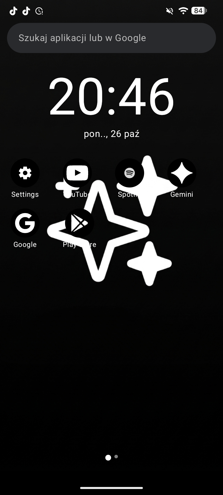
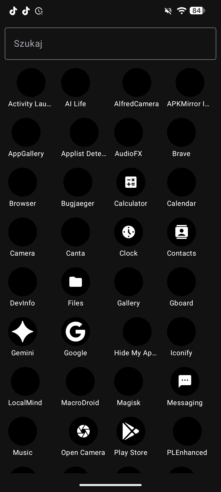
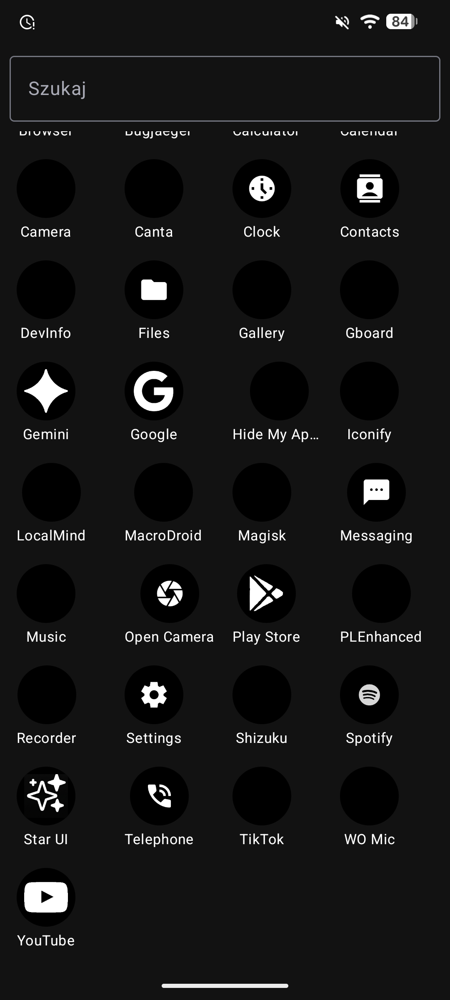
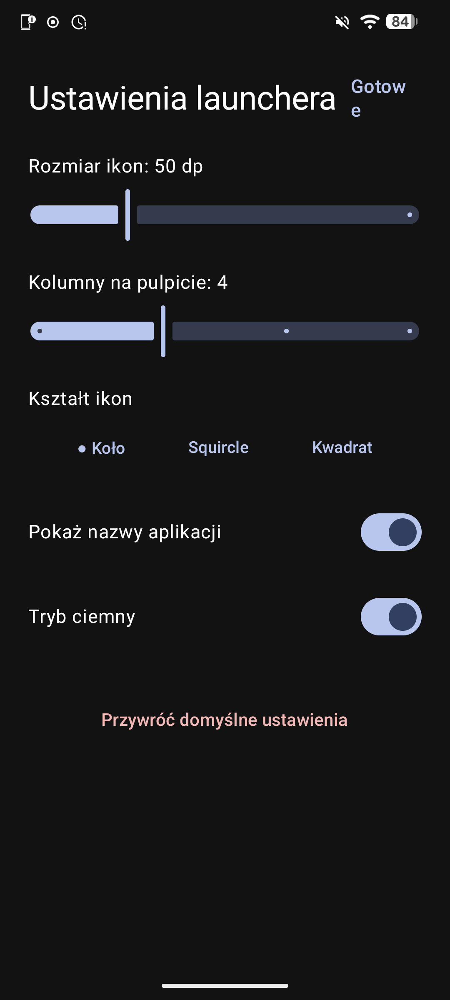
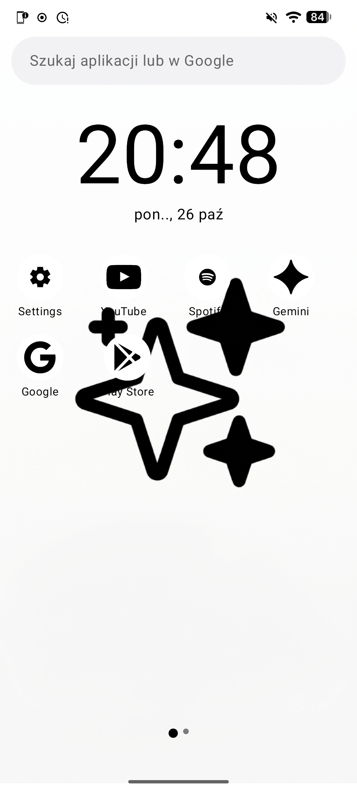
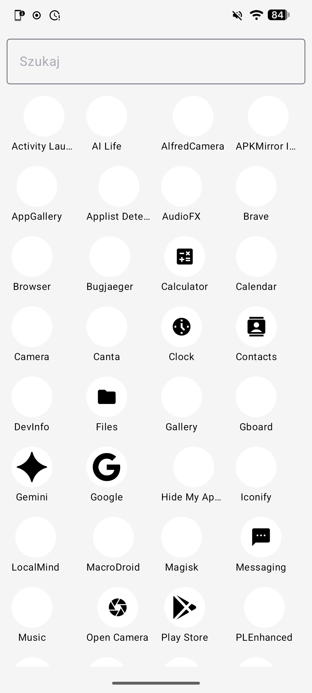
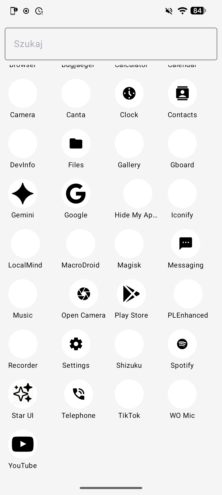
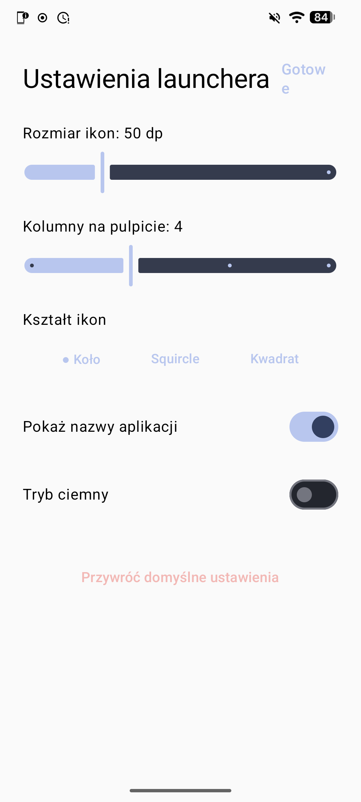

<p align="center">
  
</p>

<p align="center">
  <b>English</b> &nbsp;|&nbsp; <a href="README.pl.md">Polski</a>
</p>

<p align="center">
  <a href="https://github.com/debil38/Star-Ui/releases"><b>Download APK</b></a>
  &nbsp;•&nbsp;
  <a href="https://github.com/debil38/Star-Ui/issues">Report a bug</a>
</p>

<p align="center">
  
  
  
</p>

---

> ⚠️ **Pre-release.** This is an early test version. Expect bugs, and features may change.

## Screenshots ## (screenshot from galaxy a52s)

<p align="center">
  
  
  
  
  
  
  
  
</p>


## Features

- **Multi-page home screen** that remembers the last page you were on
- **Dock** with up to 5 favorite apps
- **App drawer** with search
- **Home screen search**: find an app or search Google
- **Clock and date** on the main page
- **Light and dark mode** with a smooth transition
- **Uniform custom icons** for popular apps and a monochrome style for the rest
- **Icon shape**: circle, squircle or square
- **Wallpapers** for home, lock screen or both, picked from your gallery
- **Long-press menu on icons**: add to home or dock, app info, uninstall
- **Settings**: icon size, columns, app labels, dark mode, reset to defaults

## Installation

1. Go to [Releases](https://github.com/debil38/Star-Ui/releases) and download `StarUI.apk`.
2. Allow installation from unknown sources if Android asks.
3. Install the app and press **Home**.
4. Choose **Star UI** as your default home app.

## Gestures

| Action | Result |
|---|---|
| Long-press empty space | Wallpaper, new page, settings |
| Double-tap empty space | Launcher settings |
| Long-press an icon | App menu |
| Back or Home | Return to the first page |

## Requirements

- Android 8.0 or newer (Android 14+ recommended)

## Tested on

| Device | System | Notes |
|---|---|---|
| Samsung Galaxy A52s | LineageOS (Android 16) | Works well, with occasional lag in the app drawer |
| Samsung Galaxy A55 | Official Samsung system (One UI) | Works well |

Tested on other devices? Let me know in an [Issue](https://github.com/debil38/Star-Ui/issues).

## Known issues

- Occasional lag when scrolling the app drawer on the Galaxy A52s.

## Building from source

1. Install [Android Studio](https://developer.android.com/studio).
2. Clone the repository:
   ```
   git clone https://github.com/debil38/Star-Ui.git
   ```
3. Open the project in Android Studio and wait for Gradle sync.
4. Connect a phone with USB debugging enabled and click **Run**.

For smooth performance, run the **release** build variant (Build → Select Build Variant).

## Limitations

Star UI is a launcher, so it does not replace the notification shade or the lock screen (both belong to the Android system). System widgets and drag-and-drop icon arranging are not available yet.

## Roadmap

- [ ] Drag and drop icon arranging
- [ ] Home screen folders
- [ ] Notification and quick settings panel
- [ ] Notification dots on icons
- [ ] Gestures and widgets
- [ ] Smoother app drawer scrolling

## Reporting bugs

Open an [Issue](https://github.com/debil38/Star-Ui/issues) and include your phone model, Android version and the steps that led to the problem. For a pre-release, every report helps.
